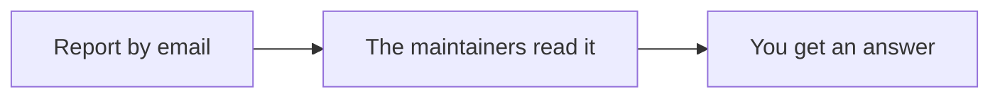

# Code of conduct

SoulCraft's repositories follow the [Contributor Covenant, version 2.1](https://www.contributor-covenant.org/version/2/1/code_of_conduct/).
Be considerate, assume good faith, and keep discussion about the work.

Report unacceptable behaviour to support@soulcraft.computer (subject "conduct"). Reports are read by the maintainers only and answered.
