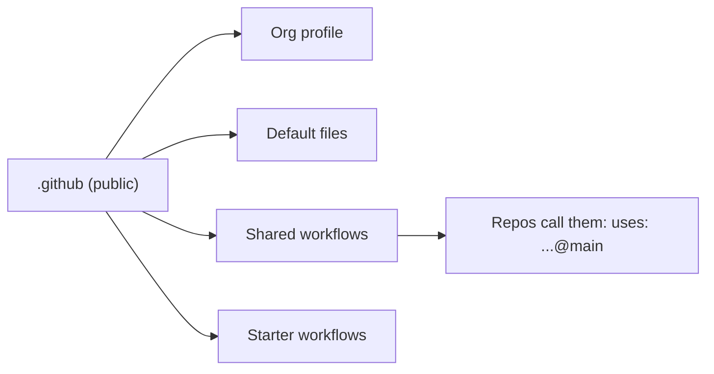

# SoulCraft-Org/.github

The org's front door. GitHub reads the profile and the default community files only from a public repository named `.github`.



| Gives | Details |
|---|---|
| Org profile | The page at [github.com/SoulCraft-Org](https://github.com/SoulCraft-Org) |
| Default files | Contributing, security, support, conduct, issue forms and a pull request template, for every repo without its own |
| Shared workflows | `gitleaks.yml`, `gemini-review.yml`, `dependabot-automerge.yml` |
| Starter workflows | [`workflow-templates/`](workflow-templates/): CI standard, Quality pages, secret scan. Copy one into `.github/workflows/` |
| Quality pages | [Quality, Speed and Consumption](https://soulcraft-org.github.io/.github/) and the Process page, built by [Git Crafter](https://github.com/SoulCraft-Org/git-crafter) |

## Call a shared workflow

Callers use `@main`, so a change here reaches every caller. `gemini-review.yml` needs the variables named in its header.

```yaml
# gitleaks.yml: scans the whole git history for secrets
on: [push, pull_request]
permissions: {}
jobs:
  gitleaks:
    permissions: {contents: read}
    uses: SoulCraft-Org/.github/.github/workflows/gitleaks.yml@main
```

```yaml
# dependabot-automerge.yml: turns on auto-merge for Dependabot pull requests
on: pull_request
permissions: {}
jobs:
  automerge:
    permissions: {contents: write, pull-requests: write}
    uses: SoulCraft-Org/.github/.github/workflows/dependabot-automerge.yml@main
```

```yaml
# gemini-review.yml: an advisory Gemini review on each pull request
on:
  pull_request:
    types: [opened, reopened, ready_for_review]
permissions: {}
jobs:
  review:
    permissions: {contents: read, id-token: write, pull-requests: write}
    uses: SoulCraft-Org/.github/.github/workflows/gemini-review.yml@main
```

## Folder map

| Folder | Holds |
|---|---|
| `.github/` | Shared workflows, issue forms, pull request template, code owners, Dependabot config |
| `profile/` | The org profile page and its images |
| `quality/` | The Quality and Process pages' config: tabs, targets, 9 process maps |
| `workflow-templates/` | Starter workflows anyone can copy |
