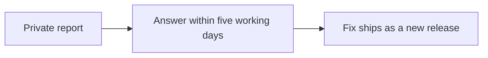

# Security

Report a vulnerability privately, never in a public issue.

| Order | How |
|---|---|
| 1 | GitHub private vulnerability reporting: the repository's **Security** tab, then **Report a vulnerability** |
| 2 | Email support@soulcraft.computer with the subject "security" |

Say what is affected (repository, version or commit), how to reproduce it, and what an attacker gains. You get an answer
within five working days. Fixes ship as a new release.

Secrets never belong in a repository. Keys come from the environment or the provider's own config.
