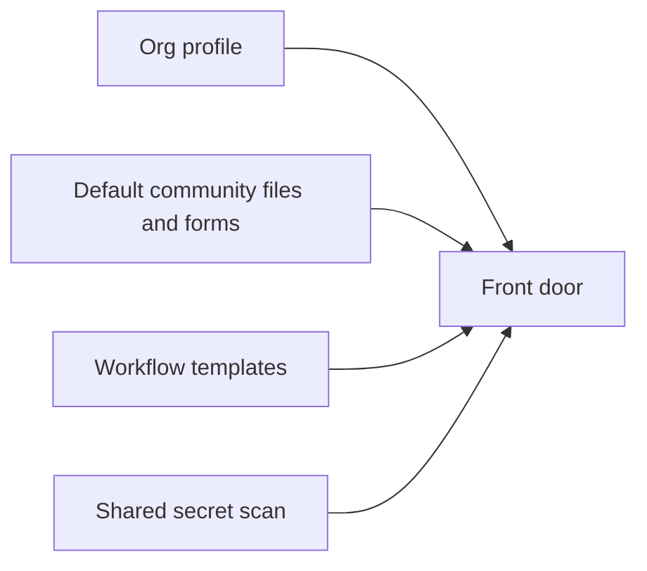

# .github spec

| Status | Repo | Tracks |
|---|---|---|
| Draft, 2026-11-25 | SoulCraft-Org/.github, public | [#35](https://github.com/SoulCraft-Org/.github/issues/35) |

**Purpose.** SoulCraft-Org's front door: the public profile, default community files, shared workflows and templates anyone can copy. The name stays `.github` because GitHub reads the profile and default files only from that name.

## Goals

| Goal | Measured by |
|---|---|
| Nothing here helps an attacker | Fork pull requests need approval, and public repos reach no private compute |
| Nothing personal, company or secret in public | Text-only docs, a generic support address, gitleaks on every push |
| Templates the public can copy | Three workflow templates show under New workflow, and a copy runs green |
| Own pages at 100 | Quality, Speed and Consumption over every measured metric |
| Local equals remote | `git status -sb` shows no ahead or behind |

## Not goals

| Out | Why |
|---|---|
| Private package CI | Moved to the private infrastructure repo on 2026-11-23 |
| Per-repo files | A repo's own files win over the defaults |

## Parts

| Part | Holds |
|---|---|
| `profile/README.md` | The org profile |
| Repo root and `.github/` | Default community files, issue forms and the pull request template, from Git Crafter's templates |
| `workflow-templates/` | Three starters: CI standard, Quality pages, secret scan |
| `gitleaks.yml` | The secret scan |
| `gemini-review.yml` | The review gate. It stops itself on 2026-12-05 |

## Open choices

| # | Choice | Recommendation |
|---|---|---|
| 1 | Org defaults add files only, or also replace the defaults repos carry | Add only |
| 2 | Gemini review after 2026-12-05: keep it, or let the gate stop it | Let the gate stop it |
| 3 | Workflow templates: three starters, or more | Three. Add one when an adopting repo asks |
