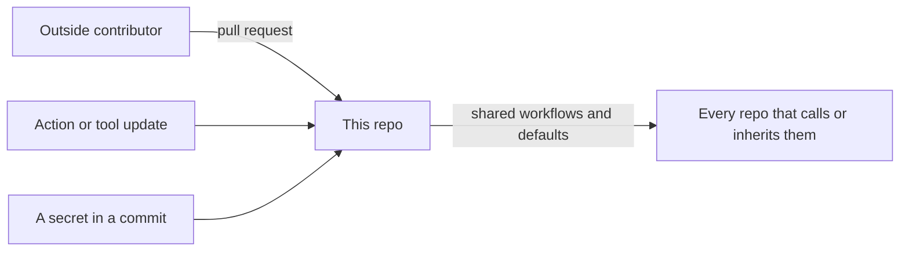

# Threat model

What can go wrong in the org's shared defaults and workflows, and what stops it. Nothing private lives here.

## Assets

| Asset | Why it matters |
| --- | --- |
| Shared workflows | A change runs in every repo that calls them |
| Default files | Forms, policies and templates that repos without their own copy show |
| Run tokens | Each reaches its own repo, for the length of one run |
| Git history | A leaked secret stays in it |

## Threats and controls

| Threat | Control |
| --- | --- |
| Hostile code from an outside pull request runs with the repo's rights | Approval before an outside contributor's run starts; a fork's run gets no secrets |
| Untrusted text (a title, a branch name, a body) turns into shell code | Passed through environment variables, never written into a script |
| A moved tag or a poisoned action release ships hostile code | Every action pinned to a full commit SHA; Dependabot waits 14 days before proposing a release |
| A secret reaches the history | A scan of the whole history on every change, push protection, and a pre-commit hook |
| A token can do more than its job needs | Read-only at the top of each workflow, write on the one job that needs it, keyless sign-in |
| A bad shared change reaches every caller at once | Code owner review, a required check, and callers pinned to a commit |
| A default file misleads or links somewhere unsafe | Every change is a reviewed pull request; each build checks the links |

## Residual risk

| Risk | Why it stays |
| --- | --- |
| Dependabot updates merge themselves | The cooldown, the scan and the required check are the only gates |
| The review comment is advisory | It never blocks a merge, so a person's review stays the gate |

Review this file when a workflow gains a trigger, a permission or a caller.
