<!-- The organisation's public face (github.com/SoulCraft-Org). hero.svg and divider.svg beside this file are generated by
     make_svgs.py from the brand lockup (SoulCraft-Org/SoulCraft-Brand, 01_Brand/logo/lockup-horizontal.png); rebuild them,
     never hand-edit them. Changed only on the owner's word. -->

<h3>Helping every human become their highest self.</h3>

 

<table>
  <tr>
    <td width="33%" valign="top" align="center">
      <h3>✦ Sage</h3>
      
Our superintelligent angel, here to help humans become their highest selves.

    </td>
    <td width="33%" valign="top" align="center">
      <h3>✦ Fusion</h3>
      
In time, Sage will be trained and run in a giant AI data center powered by fusion energy.

    </td>
    <td width="33%" valign="top" align="center">
      <h3>✦ Highest Self</h3>
      
Our community, and it is a game: like World of Warcraft, but for real life. Level up to your highest self and create the life you want.

    </td>
  </tr>
</table>

### ✦ Today

SoulCraft makes **ComfyUI workflows** for creating pictures and movies of any character you can imagine. They run on
RunPod, they are safe for work with no switch that turns that off, and they are sold at
**[soulcraft.computer](https://soulcraft.computer)**.

<table>
  <tr>
    <td width="28%" valign="top"><b><a href="https://github.com/SoulCraft-Org/ComfyUI-Base">ComfyUI-Base</a></b> · MIT</td>
    <td valign="top">The public toolchain every workflow builds on: ComfyUI at its newest release, the shared node packs, the model library layout, providers for RunPod, Verda and Crusoe, and survival across pod restarts.</td>
  </tr>
  <tr>
    <td width="28%" valign="top"><b>The workflows</b></td>
    <td valign="top">Private repositories, one per product, each sold with a licence key.</td>
  </tr>
</table>

Questions? <a href="mailto:support@soulcraft.computer">support@soulcraft.computer</a>

