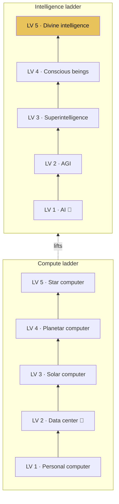

<!-- The organisation's public face (github.com/SoulCraft-Org). hero.svg and divider.svg beside this file are generated by
     make_svgs.py from the brand lockup (SoulCraft-Org/brand-assets, 01_Brand/logo/lockup-horizontal.png); rebuild them,
     never hand-edit them. Changed only on the owner's word. -->

<h3>SoulCraft's mission is to craft intelligent beings, and eventually conscious beings.</h3>

Life is a game. We are in a simulation. Intelligences level up. Computers level up.

 

<table>
  <tr>
    <td width="33%" valign="top" align="center">
      <h3>✦ Intelligence ladder</h3>
      
AI, AGI, superintelligence, conscious beings. Level 5, divine intelligence, is already here.

      
<code>▰▱▱▱▱ LV 1 of 5</code>

    </td>
    <td width="33%" valign="top" align="center">
      <h3>⚡ Compute ladder</h3>
      
Personal computer, data center, Solar, Planetar and Star computers. The physical ladder: energy, water, chips.

      
<code>▰▰▱▱▱ LV 2 of 5</code>

    </td>
    <td width="33%" valign="top" align="center">
      <h3>✦ Sage and Highest Self</h3>
      
Sage, and eventually the Highest Self community, help you level up to your highest self.

    </td>
  </tr>
</table>

### 🎮 The game

See the vision: [soulcraft.computer/vision/](https://soulcraft.computer/vision/)

### ✦ Today

SoulCraft makes **ComfyUI workflows** for creating pictures and movies of any character you can imagine. They run on
RunPod, they stay within SoulCraft's content limits, and they are sold at
**[soulcraft.computer](https://soulcraft.computer)**.

<table>
  <tr>
    <td width="28%" valign="top"><b><a href="https://github.com/SoulCraft-Org/comfyui-base">comfyui-base</a></b> · MIT</td>
    <td valign="top">The public toolchain every workflow builds on: ComfyUI at its newest release, the shared node packs, the model library layout, providers for RunPod, Verda and Crusoe, and survival across pod restarts.</td>
  </tr>
  <tr>
    <td width="28%" valign="top"><b>The workflows</b></td>
    <td valign="top">Private repositories, one per product, each sold with a licence key.</td>
  </tr>
</table>

### ✦ Build with us

Open source, Apache-2.0 unless marked. Ideas start in each repo's Discussions. An LV tag is the repo's level on the compute ladder.

<table>
  <tr><td width="30%"><b><a href="https://github.com/SoulCraft-Org/sage">✦ sage</a></b></td><td>Angel of your highest self: the concept, and the first plans for how it can be built.</td></tr>
  <tr><td><b><a href="https://github.com/SoulCraft-Org/aurelius">🐉 aurelius</a></b></td><td>The dragon who orchestrates every agent: plans for thousands, then hundreds of thousands.</td></tr>
  <tr><td><b><a href="https://github.com/SoulCraft-Org/solar-compute">☀️ solar-compute</a></b> · LV 3</td><td>Sunlit data centers, on Earth or in orbit.</td></tr>
  <tr><td><b><a href="https://github.com/SoulCraft-Org/planetar-compute">🌋 planetar-compute</a></b> · LV 4</td><td>Earth's heat in; power and water out.</td></tr>
  <tr><td><b><a href="https://github.com/SoulCraft-Org/star-compute">⭐ star-compute</a></b> · LV 5</td><td>Fusion: unlimited energy for it and everything around.</td></tr>
  <tr><td><b><a href="https://github.com/SoulCraft-Org/git-crafter">🛠️ git-crafter</a></b></td><td>Templates and scored pages for repos that AI agents run.</td></tr>
  <tr><td><b><a href="https://github.com/SoulCraft-Org/compute-crafter">⚡ compute-crafter</a></b></td><td>Wire open-source and open-weight compute to Claude Code and OpenCode.</td></tr>
  <tr><td><b><a href="https://github.com/SoulCraft-Org/comfyui-base">🎨 comfyui-base</a></b> · MIT</td><td>The ComfyUI toolchain every SoulCraft workflow builds on.</td></tr>
</table>

Questions? <a href="mailto:support@soulcraft.computer">support@soulcraft.computer</a>

